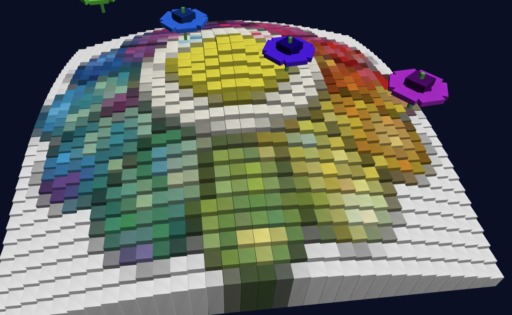
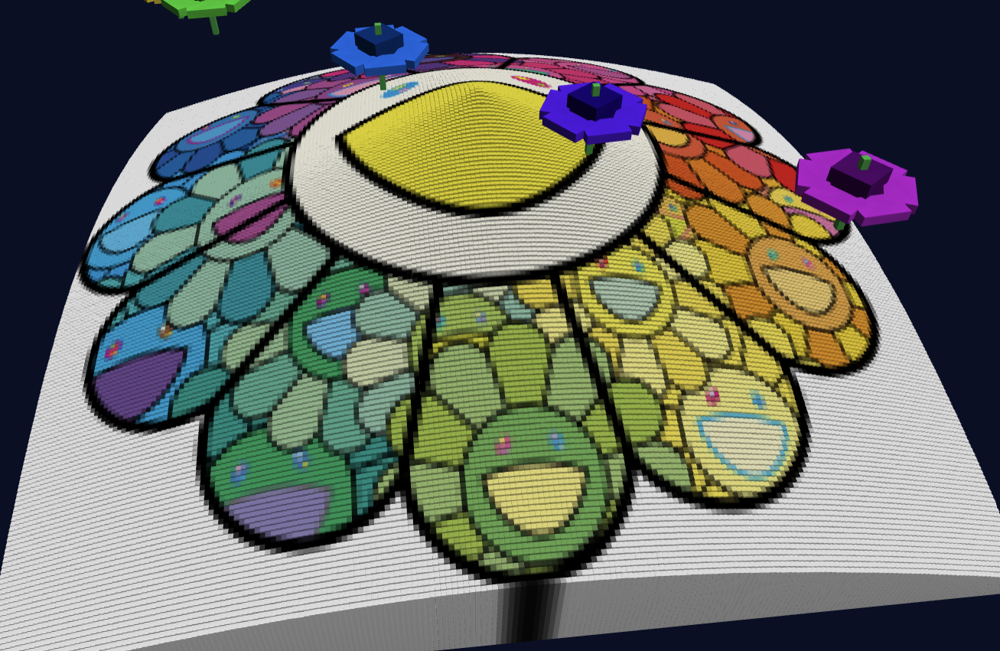
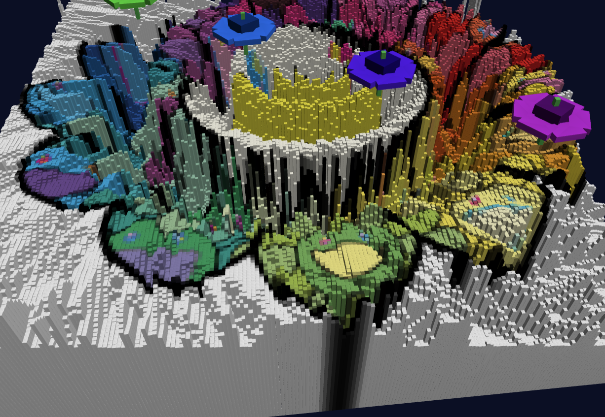
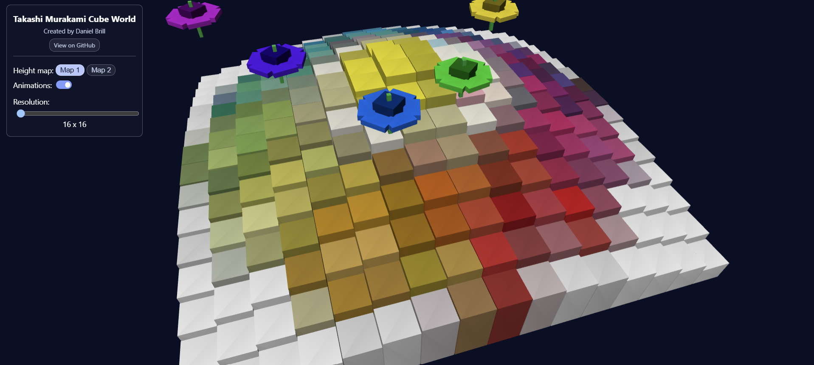

# CS 5160 Project 2 | Takashi Murakami Cube World

<div style="display: flex; justify-content: center; align-items: center; gap: 16px; flex-wrap: wrap;">
    
    
    
</div>

Cube World is an interactive WebGL landscape built entirely from cube models. A color image determines the appearance of the terrain, while grayscale height maps determine the height of each cube. Above the landscape, seven rainbow-colored cube flowers move along separated Bezier paths.

The project is implemented with plain HTML, CSS, JavaScript, and WebGL. It does not use Three.js or another graphics framework.

## Table of Contents

- [Try It!](#try-it)
  - [Controls](#controls)
  - [Live Demo](#live-demo)
- [Design](#design)
  - [Design Concept](#design-concept)
  - [Source Images and Height Maps](#source-images-and-height-maps)
- [Implementation](#implementation)
  - [WebGL Setup and Shaders](#webgl-setup-and-shaders)
  - [Cubes as Triangles](#cubes-as-triangles)
  - [Transformations](#transformations)
  - [Fixed-Size World and Resolution](#fixed-size-world-and-resolution)
  - [Image Sampling](#image-sampling)
  - [Camera and Perspective Projection](#camera-and-perspective-projection)
  - [Bezier Flowers](#bezier-flowers)
  - [Animation Loop](#animation-loop)
- [Connections to Computer Graphics Concepts](#connections-to-computer-graphics-concepts)
- [Level-by-Level Coverage](#level-by-level-coverage)
- [Performance and Compatibility](#performance-and-compatibility)
- [AI Usage](#ai-usage)
- [Future Work](#future-work)

## Try It!

The project is hosted publicly on GitHub Pages:

<p>
    <a href="https://danielbrill20.github.io/cs5160-cube-world/">Open the hosted Cube World application</a>
</p>

The source code is available here:

<p>
    <a href="https://github.com/DanielBrill20/cs5160-cube-world">View the project source on GitHub</a>
</p>

### Controls

- **Height map buttons:** Select Map 1 or Map 2 to rebuild the terrain from a different grayscale source image.
- **Animations toggle:** Pause and resume the orbiting camera and moving flowers without resetting their positions.
- **Resolution slider:** Increase or decrease the number of cubes used to sample and display the landscape.

## Live Demo

<a href="https://youtu.be/M_5YniMVcjw">
    
</a>

The demo video shows the WebGL landscape, the image-based terrain, the height map controls, the resolution slider, the animated camera, and the seven moving flowers.

## Design

### Design Concept

The visual concept is a small, abstract world inspired by the bright and playful colors associated with Takashi Murakami's artwork. The ground is not a continuous mesh. Instead, it is constructed from individual cubes, making the landscape feel graphical and intentionally assembled.

The color image gives the terrain a varied illustrated appearance. The grayscale images turn light and dark regions into hills and valleys, allowing the source images to become both visual and geometric information.

The sky contains seven colorful flowers. Each flower is built from a center cube, six petal cubes, and a stem cube. The flowers use rainbow colors, move along separate Bezier paths, and travel in the opposite direction from the camera so their motion is easy to perceive.

The intended experience is calm and exploratory rather than game-like. Users can change terrain resolution, compare height maps, and pause the motion while studying the relationship between image data and the resulting 3D geometry.

The original design plan is available in [world_design.pdf](world_design.pdf). It documents the visual direction and the planned cube-based landscape before implementation.

### Source Images and Height Maps

The terrain color comes from [murakami_source.webp](assets/murakami_source.webp). The two grayscale height-map sources are [grayscale_source1.jpg](assets/grayscale_source1.jpg) and [grayscale_source2.png](assets/grayscale_source2.png). The grayscale source images make the height-map process visible: darker regions become shorter cubes, while lighter regions become taller cubes.

The example images at the top of this README show the result at low resolution and with each of the two height maps selected.

## Implementation

### WebGL Setup and Shaders

The application obtains a WebGL rendering context from the canvas in `index.html`. The JavaScript creates, compiles, and links a vertex shader and fragment shader manually.

The vertex shader receives cube positions, surface normals, and colors as attributes. It also receives model, view, and projection matrices as uniforms. For every vertex, the shader applies the transformations in this order:

```text
model space -> world space -> camera space -> clip space
```

The fragment shader receives interpolated color and normal values. It computes simple directional lighting with a dot product between each surface normal and a light direction. An ambient brightness term keeps surfaces from becoming completely black.

### Cubes as Triangles

WebGL does not have a built-in cube primitive. It draws points, lines, and triangles, so the application describes one cube as 12 triangles: two triangles for each of the six faces.

The cube geometry is uploaded to a GPU buffer once and reused for the entire landscape and all flowers. The model matrix changes the position, scale, and rotation for each cube, while a dynamic color buffer allows different cubes to use different colors.

### Transformations

The `model` helper builds a transformation matrix for each cube. It combines translation, scaling, and rotation around the y-axis.

Terrain cubes are translated across the x-z plane and scaled in the y direction according to their heights. Flower components use the same cube model with different translations, scales, and rotations to form centers, petals, and stems.

This demonstrates the role of transformations in constructing complex scenes from a single reusable primitive.

### Fixed-Size World and Resolution

The `worldSize` variable defines the width and depth of the terrain. For a resolution of `n`, each cube's width and depth are calculated from the fixed world size:

```text
cubeSize = worldSize / n
```

The cube centers are distributed symmetrically around the origin. A 16 x 16 world and a 200 x 200 world therefore cover the same physical area. Higher resolution adds detail without making the scene grow.

Cube heights no longer depend on resolution. They are determined only by the grayscale image, which makes the terrain shape consistent when the user changes the slider.

### Image Sampling

The source images may be much larger than the cube grid. The `sampleRegion` function maps each grid cell to a rectangular region of the image and averages all pixels in that region.

For the color image, the average red, green, and blue channels become the cube color. This means a 100 x 100 grid can use a much larger source image without choosing only one arbitrary pixel.

For the grayscale image, the averaged channels are converted to luminance using weighted values:

```text
gray = 0.30R + 0.59G + 0.11B
```

The normalized luminance is mapped to a real cube height. Dark regions produce shorter cubes and light regions produce taller cubes.

### Camera and Perspective Projection

The camera is represented by the view matrix rather than by moving the terrain. The `lookAt` helper constructs camera axes using normalized vectors, cross products, and dot products. The camera points toward the center of the landscape while moving around it.

The camera position is calculated from an angle:

```text
x = cos(angle) * radius
z = sin(angle) * radius
```

The camera's y-coordinate is higher than the terrain, producing an overhead view. The camera angle advances during animation, creating an orbit around the scene.

The `perspective` helper creates a perspective projection matrix. This represents the pinhole-camera model discussed in class: nearby objects appear larger and distant objects appear smaller. The projection maps camera-space coordinates into clip space, after which WebGL performs the perspective divide and viewport mapping.

### Bezier Flowers

Each flower follows a cubic Bezier curve with four control points. The application uses the standard cubic formulation:

```text
B(t) = (1-t)^3P0 + 3(1-t)^2tP1 + 3(1-t)t^2P2 + t^3P3
```

The first and last control points define the endpoints, while the two interior control points determine the direction and curvature of the path. The parameter moves from 0 to 1 and back to 0, so a flower reverses smoothly at each endpoint instead of teleporting.

The seven paths occupy separated depth lanes. Their spacing is larger than the flower footprint, preventing the flowers from colliding while they move. Each flower has its own phase offset and color, but all six petals on a given flower share that flower's color.

### Animation Loop

`requestAnimationFrame` calls the `draw` function once per display frame. Each frame resizes the canvas, updates the viewport, advances accumulated animation time when enabled, updates the camera angle, clears the color and depth buffers, uploads the projection and view matrices, draws the terrain cubes, and draws all seven flowers.

Depth testing allows nearer triangles to hide farther triangles. This is necessary for a three-dimensional scene assembled from many triangles and cube models.

## Connections to Computer Graphics Concepts

- **Vertices, edges, and triangles:** The cube is represented by vertices and normals and rendered as 12 triangles.
- **GPU buffers:** Static cube geometry is uploaded once and reused, while dynamic color data is updated for each cube.
- **Attributes, uniforms, and varyings:** Attributes provide per-vertex data, uniforms provide per-draw matrices, and varyings carry values from the vertex shader to the fragment shader.
- **Transformations:** Model matrices translate, scale, and rotate cubes.
- **Coordinate spaces:** Vertices move from object space through world space, camera space, and clip space.
- **Pinhole camera:** Perspective projection makes depth visible through distance-based scaling.
- **View matrix and `lookAt`:** Camera movement is implemented by changing the view transform rather than modifying every world object.
- **Normals and lighting:** Face normals and a dot product produce directional shading.
- **Interpolation:** Values passed through varyings are interpolated across triangle fragments by the GPU.
- **Parametric curves:** Cubic Bezier equations control the flower motion.
- **Depth buffering:** WebGL's depth test resolves visibility between triangles at different depths.

## Level-by-Level Coverage

### Level 0: Project Preliminaries

The project is a browser-based HTML, CSS, JavaScript, and WebGL application. The interface includes the project title, author credit, project controls, and a link to the source repository. The scene is built from cube models rather than imported 3D models.

### Level 1: Procedural Cube Landscape

The terrain is a grid of translated cube models. Each cube is scaled in the y direction according to height data, assigned a color, and rendered with directional lighting. The camera points toward the landscape while orbiting its center. The resolution control allows the grid density to be changed interactively.

### Level 2: Cube Landscape from Image Data

The landscape uses the color image for cube colors and either grayscale height map for cube heights. Image regions are averaged into grid cells, and grayscale luminance is converted to real cube height. The fixed `worldSize` keeps the world footprint stable at every resolution.

### Level 3: Cube-Based Skyscape

Seven flowers are assembled entirely from scaled, translated, and rotated cubes. Their movement uses cubic Bezier curves. The rainbow colors, different phases, and opposite-direction motion give the upper part of the scene an animated skyscape.

### Level 4: Additional Experiments

The fragment shader includes a directional lighting experiment. The light direction is compared with each cube face's normal, producing brighter faces that face the light and darker faces turned away from it. The scene also uses a dark blue background to establish a nighttime-like visual setting.

I also experimented with distance fog, but removed it because the result did not fit the intended visual style. It is documented as future work rather than leaving an effect that makes the scene harder to read.

## Performance and Compatibility

The default resolution is 16 x 16 to provide a responsive starting point on typical laptop browsers. The slider can increase the grid to 200 x 200, but that setting creates 40,000 cubes and may require a more capable computer.

Each cube currently uses a separate draw call, so rendering cost grows with the number of grid cells. WebGL support is required.

For best results, run the project from a web server rather than opening `index.html` directly from the file system. Browser security rules can block image loading from local files.

## AI Usage

AI tools were used as development assistants during this project. AI helped inspect the existing code, explain WebGL concepts, suggest implementation approaches, identify bugs, make focused code edits, and draft parts of this documentation.

Examples of AI-supported work include debugging animation state so the flowers and camera pause and resume correctly, organizing the control panel, calculating a fixed-size world for changing terrain resolutions, and documenting the shader, transformation, camera, image-sampling, and Bezier curve systems.

AI did not replace the project design or final decision-making. I chose the visual direction, image assets, flower concept, rainbow color scheme, camera composition, control behavior, and which suggested changes to keep or undo. I tested the application, reviewed generated changes, and revised the implementation when a result did not fit the intended appearance.

## Future Work

Possible future improvements include:

- Add a real skybox or a textured sky dome.
- Try a softer, adjustable atmospheric effect with user-controlled density and color.
- Replace one draw call per cube with instancing or batched geometry for better high-resolution performance.
- Add camera controls so visitors can adjust orbit radius, height, and speed.
- Add mouse or keyboard interaction for selecting individual terrain cells.
- Add a legend explaining how luminance maps to height.
- Add the hosted application link and narrated demo video.
- Add screenshots showing the initial scene, both height maps, multiple resolutions, the animation toggle, and the camera and flower motion.
